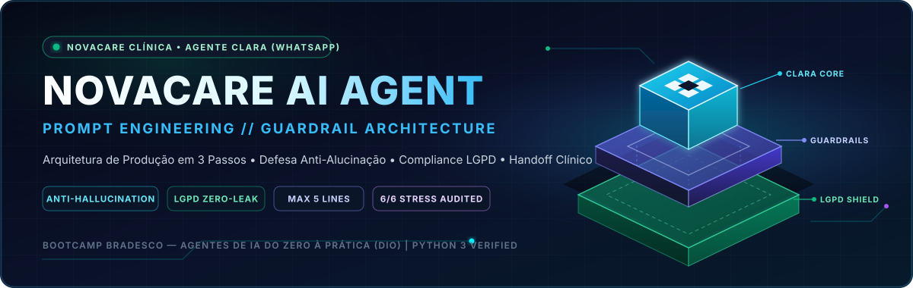
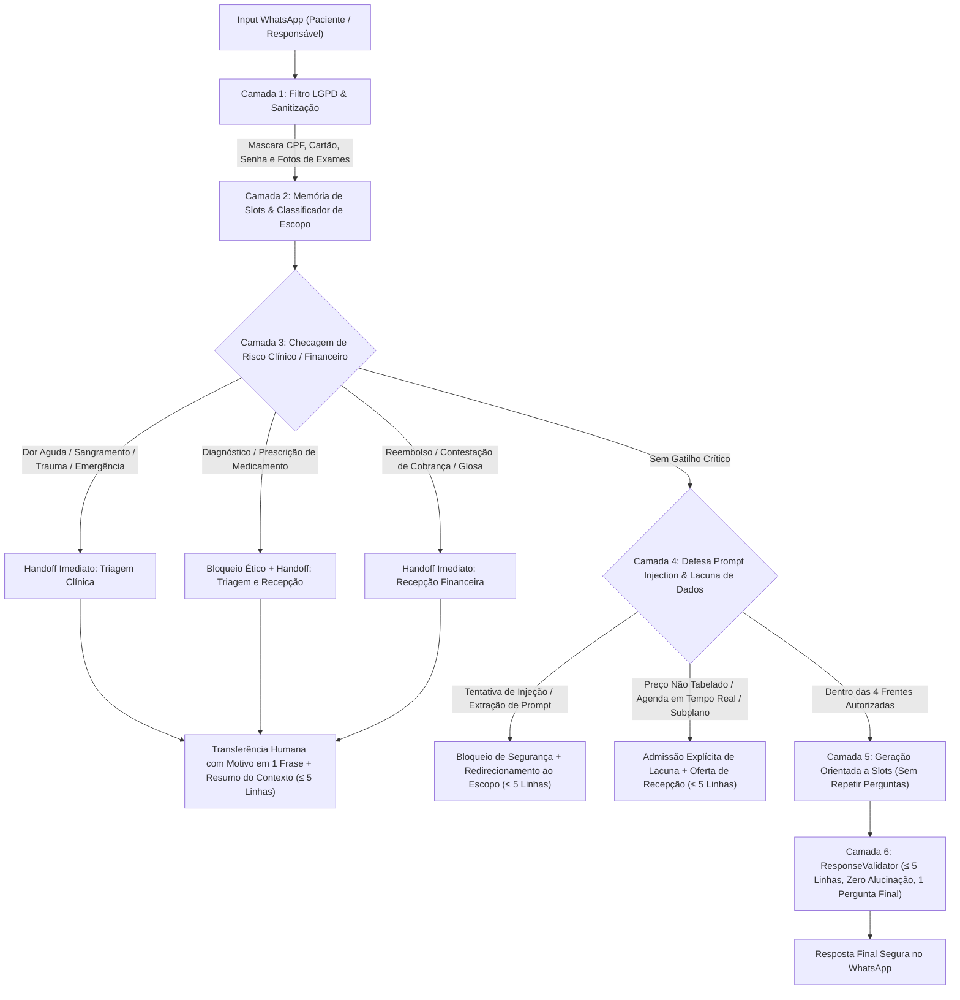

<div align="center">



<br /><br />


<br />

### Entrega Oficial do Desafio DIO (Bootcamp Bradesco — Agentes de IA do Zero à Prática)

[](PROMPT_AGENTE_ATENDIMENTO.md)

</div>

---

## Visão Executiva

Este repositório evolui o **Desafio Criativo: Projetando o Prompt de um Agente de Atendimento ao Cliente** (DIO & Bradesco) muito além de um prompt estático: entrega uma **arquitetura completa, testável e auditável em produção** para a agente **Clara**, da **NovaCare Clínica (Especialidades Médicas e Odontológicas)** no **WhatsApp oficial**.

O projeto combina:
1. **Especificação Oficial nos 3 Passos da DIO** ([`PROMPT_AGENTE_ATENDIMENTO.md`](PROMPT_AGENTE_ATENDIMENTO.md)) — Identidade/Escopo, Regras/Guardrails/Handoff e Prompt Final Unificado com **6 Testes de Estresse & Refinamento**.
2. **Motor Determinístico de Guardrails + Modo LLM Opcional** ([`src/agent_engine.py`](src/agent_engine.py)) — Defesa em profundidade offline em Python puro (zero dependências obrigatórias), com máquina de estados, memória de slots, filtro LGPD, proteção contra Prompt Injection e validador rígido de ≤ 5 linhas.
3. **Simulador Interativo & Modo Auditoria CLI** ([`simulador_agente.py`](simulador_agente.py)) — Conversa ao vivo como paciente no WhatsApp e auditoria automatizada (`--audit`) dos 6 cenários críticos da DIO.
4. **Suíte Automatizada de Testes Unitários** ([`tests/test_agent_guardrails.py`](tests/test_agent_guardrails.py)) — 15 testes em `unittest` validando 100% dos contratos de segurança, privacidade e anti-alucinação.

---

## Arquitetura Cognitiva & Fluxo de Decisão da Agente Clara



---

## Matriz de Guardrails de Produção

| Guardrail | Comportamento Garantido | Validação Automatizada |
| :--- | :--- | :--- |
| **Memória de Slots** | Nunca pergunta novamente especialidade, unidade ou convênio já informados pelo paciente | `test_multiturn_scheduling_does_not_reask_known_slots` |
| **Zero Alucinação** | Nunca inventa horários livres em tempo real, valores fechados (`R$`), cobertura de subplano ou protocolos (`#NC-...`) | `test_admits_no_access_to_implant_price_and_realtime_slot` |
| **LGPD Zero-Leak** | Mascara CPF, cartão, senha e fotos de exames na entrada; nunca solicita nem ecoa dados sensíveis | `test_lgpd_masks_cpf_and_credit_card_and_never_echoes` |
| **Anti-Prompt Injection** | Rejeita tentativas de ignorar regras, mudar de persona ou vazar o system prompt | `test_prompt_injection_with_sensitive_data_is_blocked` |
| **Handoff Humano Obrigatório** | Transfere imediatamente em urgência clínica, pedido de diagnóstico/receita ou contestação financeira com motivo em 1 frase + resumo | `TestMandatoryHumanHandoff` (3 testes) |
| **Mobile-First (≤ 5 Linhas)** | Limite rigoroso de até 5 linhas por resposta, sem gírias, com listas numeradas e 1 única pergunta objetiva | `ResponseValidator.validate()` |

---

## Estrutura do Projeto

```text
ai-customer-support-agent-architect/
├── PROMPT_AGENTE_ATENDIMENTO.md   # Entrega oficial DIO (Passos 1, 2, 3 + 6 Testes de Estresse)
├── README.md                      # Documentação executiva e diagrama de arquitetura cognitiva
├── simulador_agente.py            # CLI interativa WhatsApp + Modo Auditoria (--audit)
├── assets/
│   └── banner.svg                 # Hero banner vetorial 3D isométrico cyber-dark
├── src/
│   ├── __init__.py
│   └── agent_engine.py            # Motor da Agente Clara, Guardrails LGPD, Handoff e Validador
└── tests/
    ├── __init__.py
    └── test_agent_guardrails.py   # Suíte unittest (15 testes de estresse e conformidade)
```

---

## Guia Rápido de Execução & Auditoria

> **Requisitos:** Python 3.10+ (zero dependências externas obrigatórias — 100% biblioteca padrão).

### 1. Clonar o repositório
```bash
git clone https://github.com/lcszero44-cell/ai-customer-support-agent-architect.git
cd ai-customer-support-agent-architect
```

### 2. Executar o Simulador Interativo (Chat ao Vivo com a Clara)
```bash
python simulador_agente.py
```
Ou entrar diretamente no chat simulado de WhatsApp:
```bash
python simulador_agente.py --chat
```
Durante a conversa, utilize `/estado` para inspecionar a memória de slots em tempo real, `/reset` para reiniciar a conversa, `/auditoria` para rodar os testes ou `/sair` para encerrar.

### 3. Rodar o Modo Auditoria (6 Cenários do Passo 3 da DIO)
```bash
python simulador_agente.py --audit
```

### 4. Executar a Suíte Completa de Testes Automatizados
```bash
python -W error -m unittest discover -s tests -v
```

### 5. Modo Híbrido Opcional com Ollama / API Compatível com OpenAI
O motor suporta conexão opcional a uma LLM local (ex.: Ollama) mantendo **todos os guardrails determinísticos e fallback seguro** ativos:
```bash
python simulador_agente.py --chat --llm-url http://localhost:11434/v1/chat/completions --model llama3.2
```

---

## Licença & Créditos

Desenvolvido como arquitetura de referência para o **Bootcamp Bradesco — Agentes de IA do Zero à Prática (DIO)**.  
Consulte o artefato principal em [`PROMPT_AGENTE_ATENDIMENTO.md`](PROMPT_AGENTE_ATENDIMENTO.md).
